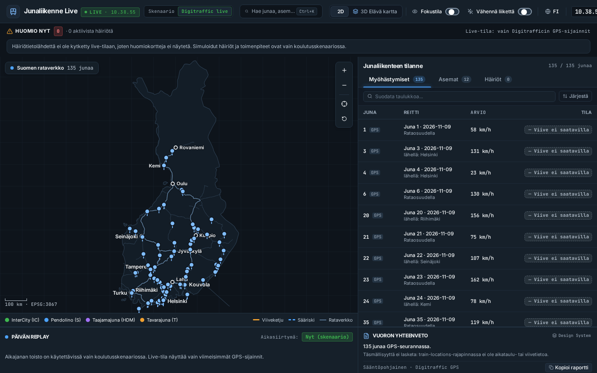
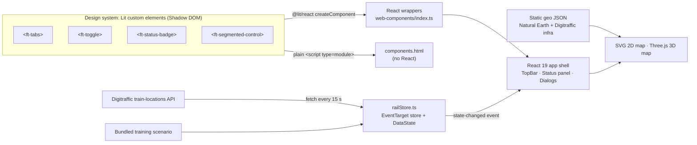

# Junaliikenne Live – Rail Traffic Monitor

[](https://github.com/sandeepariyar/Junaliikenne-Live---Rail-Traffic-Monitor/actions/workflows/deploy.yml)


A concept operator dashboard for following rail traffic and disruptions in Finland, built as a design-engineering portfolio project. Not an official Fintraffic product.

- **Dashboard:** https://sandeepariyar.github.io/Junaliikenne-Live---Rail-Traffic-Monitor/
- **Same components without React:** https://sandeepariyar.github.io/Junaliikenne-Live---Rail-Traffic-Monitor/components.html


| Digitraffic live mode (real GPS; delay shown as unavailable) | 2D network map | 3D terrain view |
| --- | --- | --- |
|  |  |  |

## What it is

- A single-page dashboard with ranked disruptions, a network map, a sortable status table, a replay timeline and a shift summary. Finnish by default, with an English toggle.
- **Training scenario (default):** train positions, delays, disruptions and suggested actions are invented example data for a winter disruption around Tampere. They are labelled "Training scenario — no real operations", and actions only change the simulated state.
- **Digitraffic live:** polls the public [Digitraffic `train-locations/latest`](https://www.digitraffic.fi/rautatieliikenne/) API every 15 s and shows only what that API provides (train number, departure date, GPS position, speed, timestamp).

## Data provenance

The data source is always visible as a badge in the top bar, with the last update time.

| State | When | What is shown |
| --- | --- | --- |
| `scenario` | Training scenario selected | Simulated trains, alerts and actions, labelled as simulated |
| `connecting` | Live selected, no response yet | No trains |
| `live` | Last successful fetch < 60 s ago | Real GPS positions and speed. Delay, passengers, train category, route and timetable are shown as **Unavailable**, because this API does not provide them |
| `stale` | Last successful fetch > 60 s ago | The last real data, with a banner giving the last update time and a retry button |
| `offline` | Live selected and fetching fails | No trains and a banner with *Retry* and *Switch to training scenario*. Nothing is replaced with demo data |

Scenario-only overlays (delay hubs, cascade track colours, station delay index, replay) are hidden or disabled in live mode.

## Architecture



- `src/components/web-components/`: the Lit elements and their `@lit/react` wrappers. The dashboard uses the wrappers for tabs, switches and status badges.
- `src/components/design-system/`: React-only components not yet migrated (`FtAlertCard`, `FtSegmentedControl`, `FtButton`, `FtTableRow`). `ft-alert-card` and `ft-segmented-control` already exist as Lit elements but are not yet used by the dashboard.
- `src/store/railStore.ts`: a small store built on the browser's `EventTarget`. Components subscribe to its `state-changed` event. It holds the UI state, the replay timer, live polling and the `DataState` model. No state library is used.
- `src/lib/trainStatus.ts`: one function that maps a train to its badge variant and text, including "Delay unavailable".
- `src/lib/shiftSummary.ts`: a **rule-based** shift summary. No language model or API key is used. In live mode it reports only the train count, because there is no delay data.
- `src/components/map/`: an SVG map in a TM35FIN (EPSG:3067-style) projection, and a Three.js low-poly terrain view.

Stack: Vite, React 19, TypeScript, Lit 3, `@lit/react`, Tailwind CSS 4, Three.js, Playwright and axe-core.

## Design engineering case study

**Problem and users.** Traffic operators need to see what needs attention now, where it is on the network, and whether the information can be trusted. The prototype explores that for Finnish rail.

**Requirements I set for myself**
- Rank attention items and keep the map and the table in sync.
- Use the keyboard for everything, and never use colour alone for status.
- Make the data's origin unmistakable. Simulated data must never look live, and live mode must never invent values.
- Build the components once and use them from any framework.

**Design-system decisions**
- **Lit custom elements as the single implementation**, consumed by React through `@lit/react`. This is the same pattern as Fintraffic's public [`fds-coreui-components`](https://github.com/fintraffic-design/fds-coreui-components) and its React wrappers. `components.html` shows the elements working without React.
- **Tokens as CSS custom properties** (`--text-primary`, `--color-info`, `--border-subtle`, …) with fallbacks, so a host app can theme through Shadow DOM. `::part(tablist)` and `::part(panel)` are exposed for layout.
- **Status = icon + text**, with a dashed `neutral` badge for missing data, so "unknown" is never shown as "on time".
- **Bilingual** labels, with `<html lang>` kept in sync.

**Data provenance.** The explicit `DataState` model above came from reviewing an earlier version. That version estimated delay from speed, generated passenger counts, and fell back to scenario trains when the API failed. I removed all three.

**Accessibility approach**
- **Target:** WCAG 2.2 AA.
- **Automated:** `@axe-core/playwright` with WCAG 2.0 to 2.2 A and AA rules, in 12 Playwright tests covering 2D, 3D, the English UI, dialogs, live, offline, stale and `components.html`. CI fails on any serious or critical violation and runs before every deploy.
- **Manual:** keyboard testing.
- **Patterns:** APG tabs, switch and radio-group patterns, dialogs with a focus trap, Escape to close and focus return, a skip link, a polite live region for notifications, `prefers-reduced-motion` plus an in-app switch, and the status table as the text alternative to the maps.
- **Limitations:** automated checks cannot prove WCAG conformance. Screen-reader testing (NVDA, VoiceOver) is in progress. The 3D view has limited keyboard interaction, so use the 2D map or the table.

**What I'd do next**
- Migrate `ft-alert-card` and `ft-segmented-control` to the wrappers and remove the remaining React duplicates.
- Get real delays from the Digitraffic `live-trains` or GraphQL timetable data instead of showing "Unavailable".
- Add a disruption feed for live mode.
- Write a manual screen-reader test report, and add visual regression tests for the components.
- Publish the elements as a separate package with docs for their API, events and tokens.

## Map data

The geometry is bundled as static JSON in `src/data/geo/`, so the demo works offline.

- **Finland outline:** [Natural Earth](https://www.naturalearthdata.com/) 1:50m admin-0 (public domain)
- **Tracks and stations:** [Digitraffic](https://www.digitraffic.fi/) infra-api `radat` and station metadata (© Fintraffic / Väylävirasto, CC BY 4.0)

To regenerate it, run `npx tsx scripts/build-geo.ts <ne_50m_admin_0_countries.geojson> <radat.geojson> <stations.json>`.

## Development

```bash
npm install
npx playwright install chromium   # once, for tests
npm run dev          # local dev server
npm run lint         # TypeScript check
npm run build        # production build to dist/ (index.html + components.html)
npm run test:a11y    # Playwright + axe accessibility tests
npm run screenshots  # regenerate docs/*.png
```

CI is in `.github/workflows/deploy.yml`. On every push to `main` it runs the type check, the accessibility tests and the build, then deploys to GitHub Pages. A failing test blocks the deploy.

## License

[MIT](LICENSE) © 2026 Sandeep Pariyar
