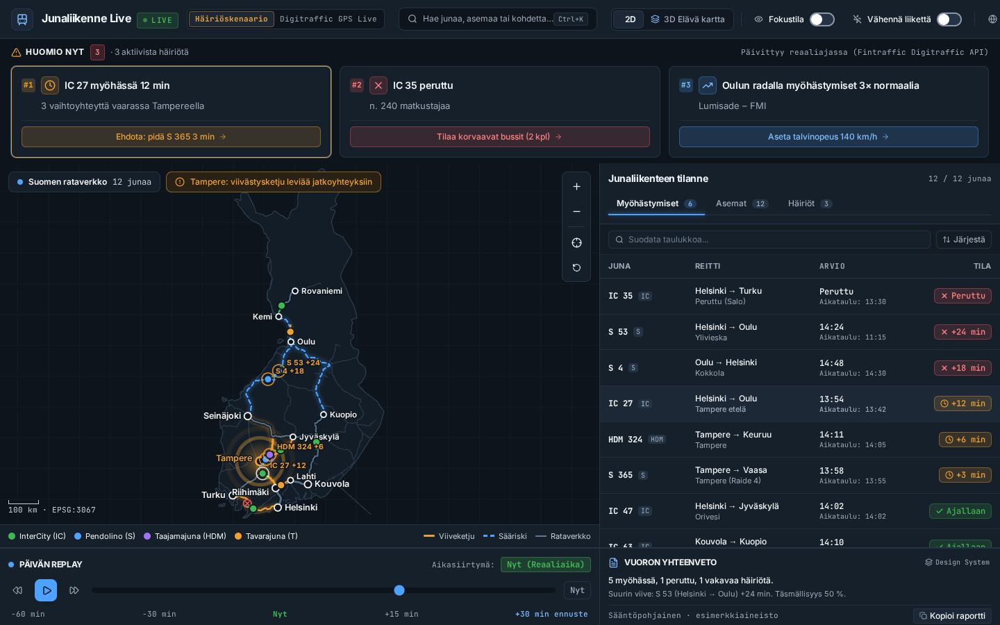
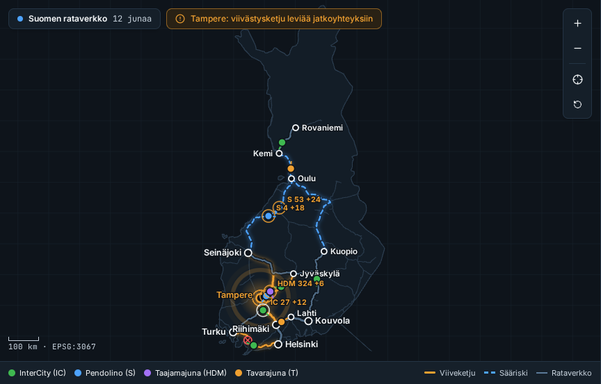
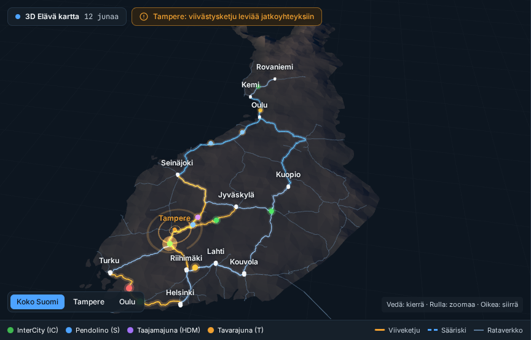

# Junaliikenne Live – Rail Traffic Monitor

A concept dashboard for following rail traffic and disruptions in Finland, built as a design-engineering portfolio project.

**Live demo:** https://sandeepariyar.github.io/Junaliikenne-Live---Rail-Traffic-Monitor/



| 2D network map | 3D terrain view |
| --- | --- |
|  |  |

## What it is

- A single-page dashboard: active disruptions, a network map, a sortable status table, a day replay timeline and a shift summary.
- The UI is in Finnish by default, with an English toggle.
- **Demo scenario (default):** the train positions, delays and disruptions are made-up example data for a winter disruption around Tampere. They are not real events.
- **Live mode:** the "Digitraffic GPS Live" mode polls the public [Digitraffic `train-locations`](https://www.digitraffic.fi/rautatieliikenne/) API and shows the real train positions on the same map.
- This is not an official Fintraffic product.

## Architecture

React app shell + reusable Lit Web Components design system (framework-agnostic).

- `src/components/design-system/`: React wrappers and Lit custom elements (`ft-tabs`, `ft-toggle`, `ft-segmented-control`, …). The Lit elements can be used without React. Open the in-app "Design System" view to see them.
- `src/components/map/RailMap2D.tsx`: an SVG map in a TM35FIN (EPSG:3067-style) projection, with zoom/pan, a legend and a scale bar.
- `src/components/map/ThreeDLiveMap.tsx`: a Three.js view. It has a low-poly Delaunay terrain with flat shading (`dFdx`/`dFdy`), glowing route tubes, moving trains, a delay ripple at the hub and OrbitControls.
- `src/store/railStore.ts`: app state (Zustand), the replay and live polling.
- `src/lib/shiftSummary.ts`: the shift summary. It is **rule-based**, calculated from the current train and disruption data. No language model or API key is used, and no secrets are bundled into the frontend.

Stack: Vite, React 19, TypeScript, Tailwind CSS 4, Lit, Three.js.

### Map data

The geometry is bundled as static JSON in `src/data/geo/`, so the demo works offline:

- Finland outline: [Natural Earth](https://www.naturalearthdata.com/) 1:50m admin-0 (public domain)
- Track geometry and stations: [Digitraffic](https://www.digitraffic.fi/) infra-api `radat` and station metadata (© Fintraffic / Väylävirasto, CC BY 4.0)

To regenerate it from the downloaded source files, run:

```bash
npx tsx scripts/build-geo.ts <ne_50m_admin_0_countries.geojson> <radat.geojson> <stations.json>
```

## Accessibility

- Tested with axe-core (`@axe-core/playwright`), 0 serious/critical violations. Manual keyboard testing.
- Implemented:
  - a skip link
  - `lang` follows the UI language
  - an `aria-live` status region for disruption updates
  - the APG tab, radio-group and switch patterns with arrow keys
  - modal dialogs with a focus trap, Escape to close and focus return
  - visible focus rings
  - `prefers-reduced-motion` and an in-app "Reduce motion" switch, which stop the 3D and ripple animation
- The status table is the text alternative to the maps.
- Not yet verified with screen readers (NVDA, VoiceOver). The 3D view has limited keyboard interaction; use the 2D map or the table instead.

## Development

```bash
npm install
npm run dev          # local dev server
npm run lint         # TypeScript check
npm run build        # production build to dist/
npm run test:a11y    # Playwright + axe accessibility tests
npm run screenshots  # regenerate docs/*.png
```

Run `npx playwright install chromium` once before running the tests. The site is deployed to GitHub Pages from the `gh-pages` branch (built `dist/`).
